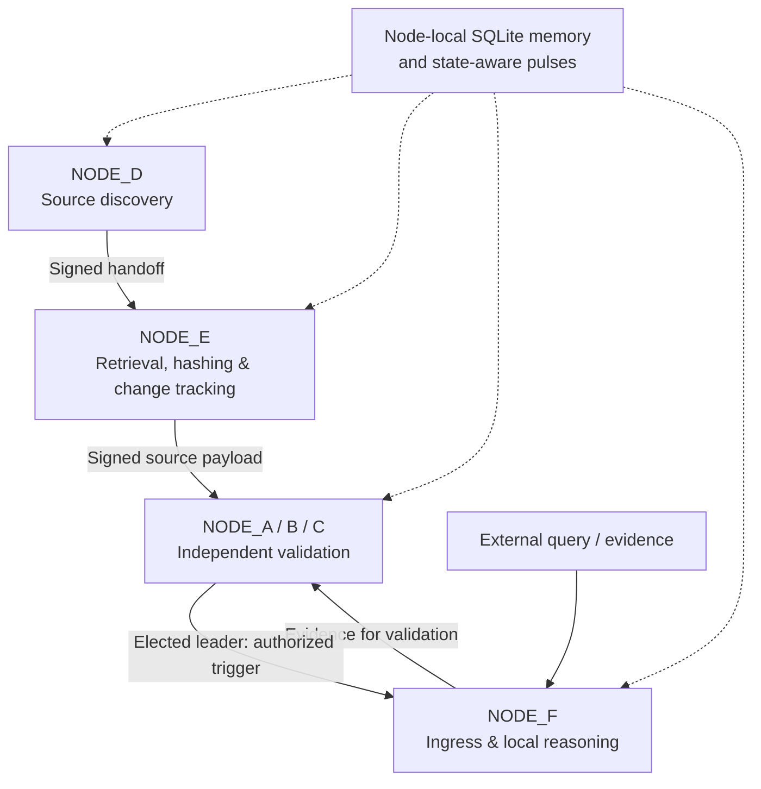

# The Observatory — AI Systems Architecture

**Zero-Point Protocol (ZPP) · Distributed AI Systems · Persistent State · Verifiable Execution**

An engineering research repository documenting the design, implementation, runtime observations, and architectural evolution of **The Observatory's experimental AI systems**.

The work investigates a recurring question:

> **What remains stable when continuity is disrupted?**

Rather than treating a language model as an isolated component, this research examines the surrounding computational environment: how source information is handled, how execution authority is assigned, how state persists, and how a system behaves when its components, context, or operating conditions change.

This repository brings together two distinct stages of development: the **earlier prototype engines** and a **later six-node Zero-Point Protocol mesh**. It preserves their history without presenting retired components as dependencies of the later system.

**Repository status:** Experimental implementation and research archive. The six-node transition was left **partially validated**; this is not a production-ready, security-certified, or independently replicated deployment.

---

## Explore the repository

| Folder | Contents | Start here |
|---|---|---|
| [`engine-archive/`](engine-archive/) | Earlier engine implementations and supporting technical records, preserved for a proposed Engine Study that has **not yet been conducted** | [Engine Archive guide](engine-archive/README.md) |
| [`framework/`](framework/) | Publication-reviewed Python snapshot of the six-node ZPP mesh, supporting modules, and active launcher for that revision | [Framework guide](framework/README.md) |
| [`architecture/`](architecture/) | Four original architecture and transition records, implementation crosswalk, and unfinished invariant audit | [Architecture guide](architecture/README.md) |
| [`runtime-evidence/`](runtime-evidence/) | Evidence register, historical failures and corrections, read-only snapshot counts, and open replication plan | [Runtime Evidence guide](runtime-evidence/README.md) |

**Suggested reading path:** [Architecture overview](architecture/current_multi_agent_architecture.md) → [Transition record](architecture/architecture_transition_record.md) → [Framework implementation](framework/README.md) → [Runtime observations](architecture/multi_agent_runtime_observations.md) → [Evidence and limitations](runtime-evidence/README.md).

## The six-node architecture

The later ZPP framework assigns different responsibilities to six independently operating nodes:

| Node | Documented responsibility |
|---|---|
| **NODE_A, NODE_B, NODE_C** | Independent validation, Gamma scoring, fluid weighting, and leader-gated dispatch |
| **NODE_D** | Local research-vault discovery and source handoff |
| **NODE_E** | Source retrieval, content hashing, change classification, and validator bridge |
| **NODE_F** | External information ingress and serialized local reasoning via Ollama / DeepSeek-R1 |

*Conceptual role and message-flow diagram—not an exhaustive network, concurrency, or trust-boundary specification. Each node maintains its **own** local persistence; the shared label in the diagram does not mean there is one shared database.*

The preserved framework includes Python implementations of WebSocket transport, Ed25519 signing, node-local SQLite memory, validator scoring, leader election, asynchronous pulse telemetry, and local inference. **Presence in source code is not the same as independently verified end-to-end behavior.**

The launcher for the supplied six-node framework revision is **[`framework/node/boot_mesh.sh`](framework/node/boot_mesh.sh)**. The earlier `start_mesh.py` is retired and is **not** the active launch path. The Bash launcher is macOS/Terminal-specific and has not been newly integration-tested in this publication package.

## Architectural evolution

The system did not begin as a six-node mesh. Its development passed through multiple implementation stages:

**Specialized prototype engines → Horizon / Pipe Horizon lifecycle experiments → centralized orchestration → distributed node roles → cryptographically identified, stateful six-node mesh.**

Some engineering concepts carried forward, including state, feedback, verification, memory, and controlled execution. Their original software components did not necessarily carry forward unchanged.

The [`engine-archive/`](engine-archive/) is therefore an **historical implementation archive**, not the set of live processing stages within the later mesh. The planned comparative Engine Study is still prospective; archived component tests should not be mistaken for that completed study.

For the documented decision history, read the [architecture transition record](architecture/architecture_transition_record.md).

## What the evidence shows—and what remains open

The original runtime-observation record reports testing of the six-node mesh, including validation behavior, local reasoning serialization, discovery-to-bridge handoffs, persistence issues, queue behavior, and corrections introduced after failures. See [observations](architecture/multi_agent_runtime_observations.md) and the [evidence register](runtime-evidence/EVIDENCE_REGISTER.md).

A separate, read-only inspection of the preserved runtime snapshot confirmed:

- **Six** readable node-local SQLite databases.
- **182** entries in the NODE_E content manifest, corresponding to **182 distinct source paths** in the inspected ledgers.
- **608** recorded entries in each of the discovery and bridge ledgers.

These counts come from different storage layers and **must not be interpreted as numbers of independent or successful inference runs**. The historical report separately describes **181 recovered reasoning streams**; those streams were **not independently re-executed or verified** during repository preparation.

**Still open:** The architecture's [15-invariant audit](architecture/architecture_invariant_audit.md) identified **seven follow-up validation tests**. The explicitly named next checkpoint was to verify **NODE_E changed-only ingestion** against the seeded 182-path manifest. A seeded manifest demonstrates a stored baseline, **not** successful changed-only processing after an edit.

Read the [open validation roadmap](architecture/OPEN_VALIDATION.md), [snapshot audit](runtime-evidence/SNAPSHOT_AUDIT.md), and [replication plan](runtime-evidence/OPEN_REPLICATION_PLAN.md) before drawing conclusions about runtime reliability.

## Inspecting the implementation

The source snapshot is in [`framework/node/`](framework/node/). Core files include [`agent_node.py`](framework/node/agent_node.py), [`crypto.py`](framework/node/crypto.py), [`memory.py`](framework/node/memory.py), [`scoring.py`](framework/node/scoring.py), and [`pulse.py`](framework/node/pulse.py).

The framework includes an [inferred requirements list](framework/requirements.txt), **not** a locked or independently verified environment. The original implementation was developed for a local macOS/Python/Ollama setup and depended on local keys, state, and configuration that have intentionally been excluded.

**Do not run the archived launcher against a real research vault or an exposed network without first reviewing the code, local file-access boundaries, dependency versions, and node identity authentication.** In particular, successful signature verification against a sender-supplied public key does not by itself establish that the sender is an authorized node.

The [framework status report](framework/STATUS_AND_LIMITATIONS.md) identifies remaining setup, integration, trust, persistence, and replay checks. No new six-node end-to-end test is claimed here.

## Provenance and publication boundaries

This repository distinguishes four evidence categories:

- **Original design / source records:** what a component was intended to do or what was recorded at the time.
- **Implemented / static:** what is present in the preserved code snapshot.
- **Historically reported:** behavior described in the original runtime observations but not newly reproduced.
- **Snapshot-verified:** aggregate properties independently inspected from the supplied archive, without running the mesh.

The supplied source was curated for publication. Private signing keys, `.env` files, local databases, raw logs, virtual environments, and private source paths were **not** uploaded. Documented publication-only path redactions were made to selected source copies; see [framework source notes](framework/SOURCE_AND_REDACTIONS.md) and [engine archive notes](engine-archive/SOURCE_NOTES.md).

Future tests should be published as **new, dated results**, with procedures, environment details, source hashes, outputs, and limitations—not retroactively inserted into the original records.

This repository does not currently declare a project-wide open-source license. Public visibility alone does not grant unrestricted reuse rights; code and documentation licensing should be reviewed separately.

---

## Research context

The engineering work is connected to The Observatory's broader investigations into **Zero-Point Protocol (ZPP)**, **Source-Locked Architecture (SLA)**, **Decoupled Inference Architecture**, **Semantic Coherence Index (SCI)**, and cross-model relational stability. Those research frameworks inform the questions being investigated; this repository does **not** claim that every published theoretical framework has been fully implemented or validated by this runtime.

Explore the wider collection in [The Observatory Research Archive](https://publish.obsidian.md/the-observatory).

**The Observatory — Independent AI Systems Research**

*“It's not the intelligence, it's the environment.”*
