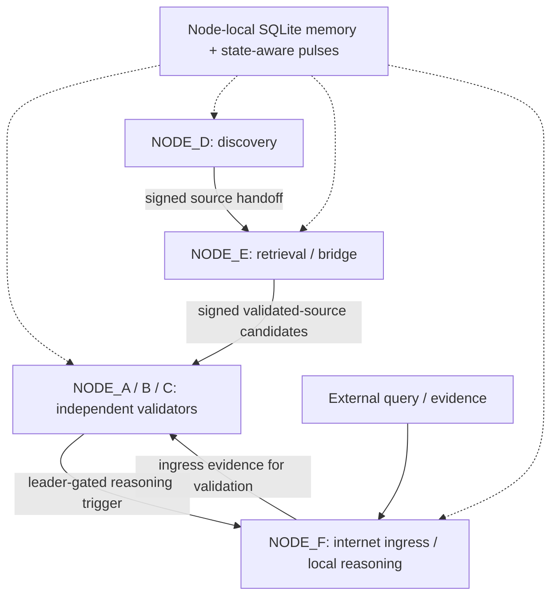

# ZPP Architecture — Design, Transition, Runtime Evidence & Invariant Audit

**The Observatory · AI Systems Architecture · September 2026 source snapshot**

This folder preserves the four **original Markdown records** supplied in `active.zip`, with a publication-oriented index. The records document the transition from early engine-based architectures to the six-node cryptographic Zero-Point Protocol (ZPP) mesh, reported runtime observations, and the **unfinished** architecture-invariant audit.

> **Status note:** Several source files use `CURRENT` or `ACTIVE` to describe the framework **at the time they were written**. These are historical source-status labels, **not a claim of a live or fully verified deployment in November 2026**. The architecture transition remained unfinished; the invariant audit was still open.

## Reading order

| Record | What it establishes |
|---|---|
| [Current Multi-Agent Architecture](current_multi_agent_architecture.md) | The documented six-node design, roles, signed transport, leader gating, persistence, local reasoning, and telemetry |
| [Architecture Transition Record](architecture_transition_record.md) | What moved from earlier engines and orchestrators into independent node responsibilities; what was retired |
| [Multi-Agent Runtime Observations](multi_agent_runtime_observations.md) | Observed outcomes and failures, including duplicate work, persistence gaps, queue behavior, and corrections |
| [Architecture Invariant Audit](architecture_invariant_audit.md) | Fifteen engineering invariants, evidence-state classifications, and seven unfinished validation tests |

## Conceptual six-node organization

This is a **role and message-flow overview**, not a complete network or trust diagram. Node-local memories are distinct databases (the shared label in the diagram does not imply a shared memory store).

## Relationship to the rest of the repository

- [`../framework/`](../framework/) — publication-reviewed Python implementation snapshot from `node.zip`. Its intended launcher is **[`boot_mesh.sh`](../framework/node/boot_mesh.sh)**; `start_mesh.py` is retired and should not be presented as active.
- [`../engine-archive/`](../engine-archive/) — historical prototype engines, a separate development stage. The proposed Engine Study was **not completed**.
- [Architecture implementation crosswalk](IMPLEMENTATION_CROSSWALK.md) — where documented responsibilities appear in the supplied source and what needs further verification.
- [Open validation roadmap](OPEN_VALIDATION.md) — the outstanding audit tests, without claiming they were executed.
- [Source notes and integrity](SOURCE_NOTES.md) — ZIP provenance and file fingerprints.

## Evidence boundaries

The archived documents distinguish *implemented*, *observed*, *reproduced*, and *validated* results. They should be read together rather than treating a design statement, a successful historical incident, or the existence of code as proof of end-to-end reproducibility. We have **not performed a new six-node integration run** for this publication package.

The four source records are included **byte-for-byte without editorial changes**; all annotations and navigation are in separately authored files. This folder does not include private keys, `.env` files, memory databases, or historical user data.
